<!-- Perfil de GitHub de Joel Candal -->

  

---

<h3 align="center">Lenguajes</h3>

  
  &nbsp;
  &nbsp;
  &nbsp;
  &nbsp;
  &nbsp;
  &nbsp;
  &nbsp;

  

<h3 align="center">Desarrollo</h3>

  
  &nbsp;
  &nbsp;
  &nbsp;
  &nbsp;

  
  &nbsp;
  &nbsp;

<h3 align="center">Herramientas y calidad</h3>

  
  &nbsp;
  &nbsp;
  &nbsp;
  &nbsp;

  
  &nbsp;
  &nbsp;
  &nbsp;
  &nbsp;
  &nbsp;

  

